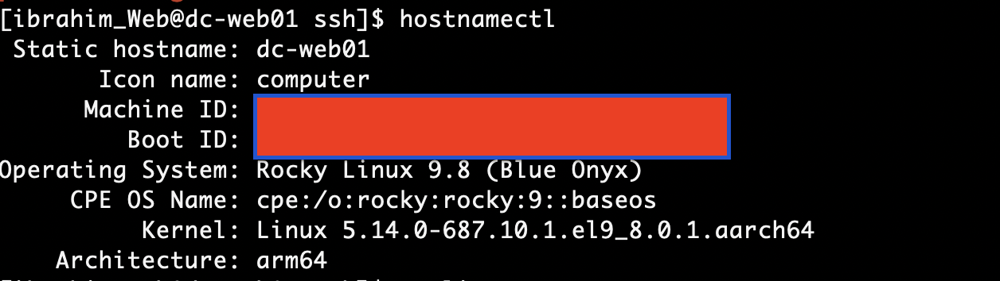
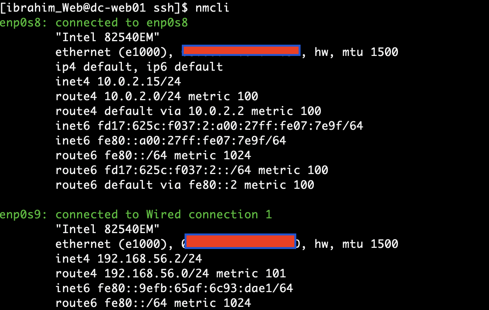

# Networking and Hostname Configuration

## Objective

Configure networking and hostname settings for a Rocky Linux 9 virtual server to provide internet connectivity and a dedicated network for remote administration from the host machine.

## Network Architecture

The Rocky Linux server (`dc-web01`) runs inside Oracle VirtualBox on an Apple Silicon Mac. Two virtual network adapters provide separate networking functions.

| Interface | Network Mode | IP Address | Purpose |
|---|---|---|---|
| `enp0s8` | NAT (DHCP) | `10.0.2.15/24` | Outbound network connectivity |
| `enp0s9` | Host-Only (Static) | `192.168.56.2/24` | Communication between the host and server |

The NAT interface uses VirtualBox's virtual gateway (`10.0.2.2`) to reach external networks.

The Host-Only interface provides direct communication between the Mac and the Linux server without exposing that interface to the external network.

## Implementation

### 1. Hostname Configuration

Configured a persistent hostname to identify the virtual server.

```bash
sudo hostnamectl set-hostname --static dc-web01
```

Verified the hostname and system information using:

```bash
hostnamectl
```

### 2. NAT Network Configuration

VirtualBox initially provided a NAT adapter (`enp0s8`) using DHCP.

Inspected the available network interfaces and routing table using:

```bash
nmcli device status
ip route
```

The routing table identified the NAT interface, its assigned source IP address (`10.0.2.15`), and its default gateway (`10.0.2.2`).

Tested external IP connectivity using:

```bash
ping -c 4 8.8.8.8
```

### 3. Host-Only Network Configuration

Added a second virtual network adapter in VirtualBox using Host-Only networking.

The Rocky Linux server recognized this adapter as `enp0s9`.

Configured the interface with the static address `192.168.56.2/24` on the `192.168.56.0/24` network.

This dedicated interface enables communication between the Mac host and the Rocky Linux server, independently of the NAT interface.

## Verification

The network configuration was validated through the following checks:

| Test | Expected Result |
|---|---|
| `hostnamectl` | Displays `dc-web01` |
| `nmcli device status` | Both network interfaces connected |
| `ip addr` | Correct addresses assigned to both interfaces |
| `ip route` | NAT default route and directly connected Host-Only network |
| `ping -c 4 8.8.8.8` | Successful external IP connectivity |
| SSH from Mac | Successful remote access to the Linux server |





## Troubleshooting

### Hostname Change Was Not Persistent

**Issue:** Initially changed the hostname using:

```bash
hostname dc-web01
```

This modified the transient hostname rather than  configuring the persistent static hostname.

**Solution:** Used `hostnamectl set-hostname --static` to configure a persistent hostname.

**Result:** The server hostname was configured as `dc-web01`.

## Skills Demonstrated

- Linux network interface management
- IPv4 addressing and subnetting
- Static IP and DHCP configuration
- VirtualBox NAT and Host-Only networking
- Linux routing table inspection
- Hostname configuration
- Network connectivity troubleshooting
