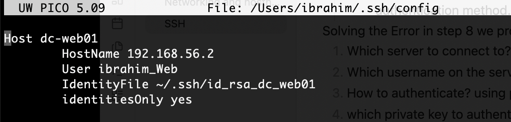
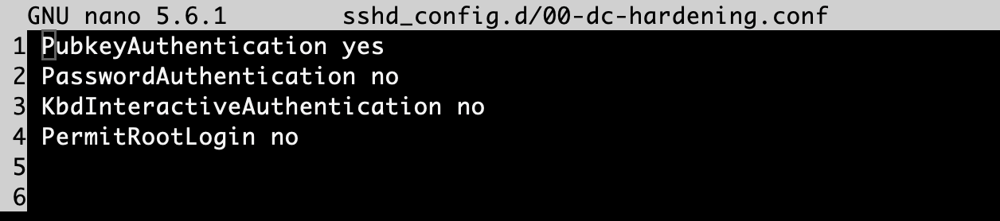
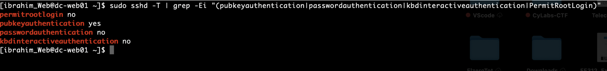
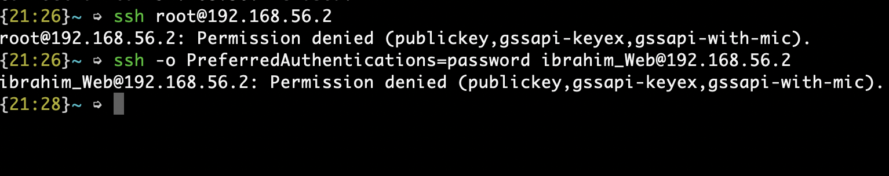

# SSH Authentication and Security Hardening

## Objective

Secure remote administration of the Rocky Linux server (`dc-web01`) by implementing SSH public-key authentication, disabling password-based authentication, and preventing direct root SSH access.

The implementation includes both SSH client configuration on macOS and OpenSSH server hardening on Rocky Linux.

## Environment

| Component | Configuration |
|---|---|
| SSH Client | macOS (Apple Silicon M1) |
| SSH Server | Rocky Linux 9.8 |
| Server Hostname | `dc-web01` |
| Server IP | `192.168.56.2` |
| SSH User | `ibrahim_Web` |
| SSH Key | RSA 4096-bit |
| Network | VirtualBox Host-Only |

## Implementation

### 1. SSH Key-Based Authentication

Generated a 4096-bit RSA key pair on the Mac client using `ssh-keygen`.

The private key was retained on the Mac, while the public key was transferred to Rocky Linux using `scp` and added to:

`~/.ssh/authorized_keys`

Configured the following permissions on the server:

| File / Directory | Permission |
|---|---|
| `~/.ssh/` | `700` |
| `~/.ssh/authorized_keys` | `600` |

This allows the SSH server to verify the client's possession of the corresponding private key without requiring the account password.

### 2. SSH Client Configuration

Configured `~/.ssh/config` on macOS to define the connection parameters for `dc-web01`.

```sshconfig
Host dc-web01
    HostName 192.168.56.2
    User ibrahim_Web
    IdentityFile ~/.ssh/id_rsa_dc_web01
    IdentitiesOnly yes
```

This configuration is SSH alias based access specifies the destination IP address, SSH username, and private key instead of constantly typing `ssh -o PreferredAuthentications=publickey -i ~/.ssh/id_rsa_dc_web01 ibrahim_Web@192.168.56.2` each time i ssh to the server 

The `IdentitiesOnly yes` option limits the identities offered by the client to those explicitly configured.



The configuration allows remote access using:

```bash
ssh dc-web01
```

### 3. SSH Server Hardening

Created a dedicated configuration file on Rocky Linux:

`/etc/ssh/sshd_config.d/00-dc-hardening.conf`

Configured the following directives:

```text
PubkeyAuthentication yes
PasswordAuthentication no
KbdInteractiveAuthentication no
PermitRootLogin no
```

| Directive | Security Purpose |
|---|---|
| `PubkeyAuthentication yes` | Enable public-key authentication |
| `PasswordAuthentication no` | Disable password-based SSH authentication |
| `KbdInteractiveAuthentication no` | Disable keyboard-interactive authentication |
| `PermitRootLogin no` | Prevent direct root SSH login |

Applied the configuration using:

```bash
sudo systemctl reload sshd
```



## Verification

### 1. Successful SSH Connection

Established a remote session from the Mac client using:

```bash
ssh dc-web01
```

The connection successfully opened a shell on Rocky Linux as `ibrahim_Web`.


### 2. Effective SSH Configuration

Verified the effective server configuration using `sshd -T`.

```bash
sudo sshd -T | grep -Ei '(pubkeyauthentication|passwordauthentication|kbdinteractiveauthentication|permitrootlogin)'
```

The output confirmed:

```text
permitrootlogin no
pubkeyauthentication yes
passwordauthentication no
kbdinteractiveauthentication no
```



### 3. Rejected Authentication Attempts

Performed two tests from the Mac client to validate authentication restrictions.

**Test 1: Direct root SSH login**

```bash
ssh root@192.168.56.2
```

Result: `Permission denied`

**Test 2: Password-based SSH authentication**

```bash
ssh -o PreferredAuthentications=password ibrahim_Web@192.168.56.2
```

Result: `Permission denied`

Together with the verified effective server settings, these tests demonstrate that direct root login and password authentication are disabled.



## Troubleshooting

### SSH Authentication and Connection Problems

**Issue**

After switching between home and university networks, SSH connections intermittently requested a password or returned:

```text
kex_exchange_identification: read: Connection reset by peer
```

**Investigation**

Performed the following diagnostic checks:

1. Verified that the Mac and Rocky Linux VM remained connected to the same Host-Only subnet.
2. Inspected the Mac's routing and interface settings using `route get` and `ifconfig`.
3. Confirmed the SSH service was running with `systemctl status sshd`.
4. Examined SSH logs using `journalctl -u sshd`.
5. Checked the effective public-key authentication configuration using `sshd -T`.
6. Reviewed SSH key configuration and SELinux-related file access considerations.

**Resolution**

Explicitly selected public-key authentication and the private key using:

```bash
ssh -o PreferredAuthentications=publickey -i ~/.ssh/id_rsa_dc_web01 ibrahim_Web@192.168.56.2
```

The connection succeeded.

Added the connection parameters to the Mac's `~/.ssh/config` file to consistently use the intended username, destination, and SSH key.

The original intermittent connection-reset behavior was not conclusively traced to a single root cause.

**Result**

Successfully established SSH sessions using the simplified command:

```bash
ssh dc-web01
```

## Skills Demonstrated

- OpenSSH client and server configuration
- RSA public-key authentication
- SSH security hardening
- Linux file permissions
- SSH client identity management
- Remote server administration
- Authentication troubleshooting
- Linux service management and log inspection
